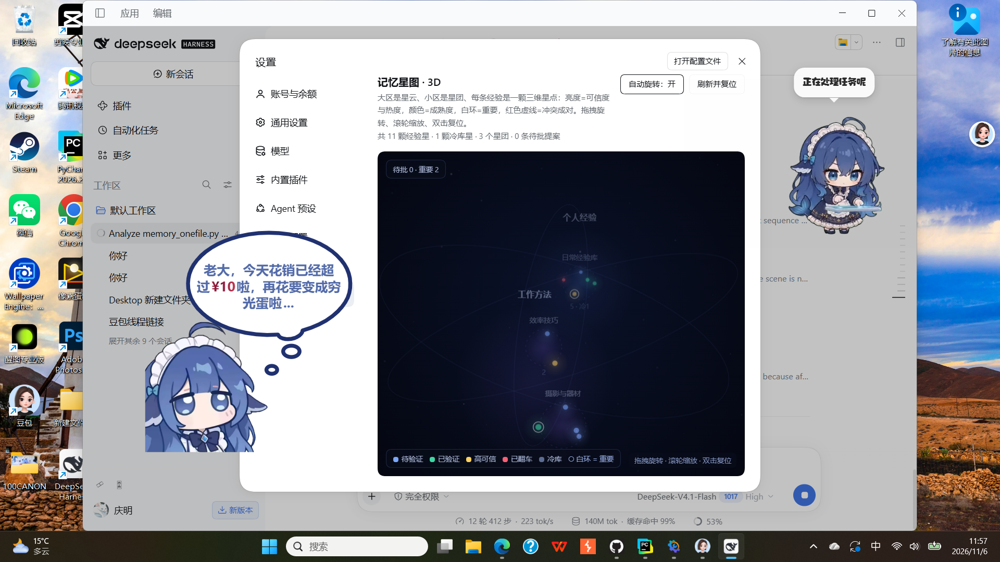
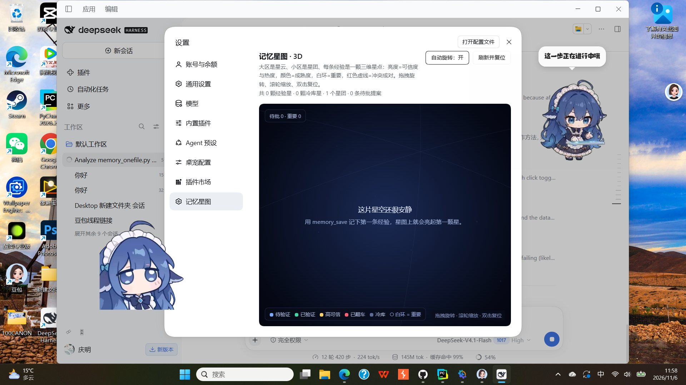

# dsh-memory

[](LICENSE)
[](#requirements)
[](https://www.python.org/)


**Long-term experience memory for any LLM running inside DeepSeek Harness.**

Your model forgets everything when the chat window scrolls away. `dsh-memory` gives it a local,
provider-agnostic memory store: it can **search past experience before starting a task**, **save
lessons the user confirms**, **report how a lesson worked out**, and **see the whole library as an
interactive 3D star map**.

No cloud, no vendor lock-in, no model-specific skill format — just five tools plus one settings page.



## Features

| | |
|---|---|
| 🔎 `memory_search` | Cross-session retrieval with relevance, confidence, maturity, premise/counter, conflicts, provenance, staleness |
| 📄 `memory_get` | Full text and metadata for one entry |
| 📊 `memory_status` | Counts, archive, pending proposals, maturity distribution, data location |
| 💾 `memory_save` | Store a lesson — summary, detail, tags, premise, counter, score, case type, pin, source reference |
| 🔁 `memory_feedback` | `good` / `bad` / `neutral` outcome, advances maturity (`draft → active → trusted`, `bad → flipped`) |
| 🌌 3D star map | Zones = nebulae, subzones = clusters, units = stars; orbit camera, click-to-focus, pending proposals fall as clickable meteors |

Design rules baked in:

- **Human in the loop.** Writes ask for approval through the Harness approval service and fail closed when it is unavailable.
- **Nothing is silently overwritten.** Conflicting lessons are kept and returned as a pair.
- **Everything is auditable.** Each entry has a version, a provenance field, and a maturity state driven only by explicit feedback.

## Requirements

- [DeepSeek Harness](https://github.com/deepseek-ai) with plugin support (`plugin_manager`), desktop or CLI profile
- Python **3.8+** available as `python` (Windows) / `python3` (macOS, Linux), or point `pythonExe` at an interpreter
- No npm dependencies. The client half is plain JavaScript and plain Canvas; there is no build step.

## Install

### 1. Get the code

```bash
git clone https://github.com/hong1413/-.git
```

Or download the repository ZIP and extract it — the folder itself is the plugin package.

### 2. Install into your DSH profile

Ask the agent (or the Plugins page) to install the bundle by directory:

```
plugin_manager: install_bundle  target = <absolute path to the dsh-memory folder>
```

That is the whole installation: the manager links the package, applies `cordis.patch.yml`, and the
five tools appear in the model's tool list.

> **Client half needs one restart.** The 3D star map lives in the Web UI. After the first install,
> quit and reopen DeepSeek Harness once; later edits to `client.js` only need a page refresh.

### 3. Configure (optional)

Configuration is a plain object on the plugin row. Every field has a working default, so an empty
config is valid:

```yaml
- insert:
    - id: dsh-memory
      name: 'dsh-memory'
      config:
        dataDir: 'C:\Users\you\AppData\Local\doubao-memory\data'
        # pythonExe: 'python'
        # timeoutMs: 30000
        # maxResults: 6
        # allowWrites: true
        # requireApproval: true
        # allowUiWrites: true
        # promptHint: true
```

| Field | Default | Meaning |
|---|---|---|
| `dataDir` | `%LOCALAPPDATA%\doubao-memory\data` (`~/.local/share` elsewhere) | Where the JSON memory store lives |
| `scriptPath` | bundled `memory_onefile.py` | Point at your own copy of the engine |
| `pythonExe` | `python` / `python3` | Interpreter to run the engine |
| `maxResults` | `6` | Default result cap for `memory_search` |
| `timeoutMs` | `30000` | Per-command timeout |
| `allowWrites` | `true` | Set `false` for a read-only deployment |
| `requireApproval` | `true` | Ask the user before writes |
| `allowUiWrites` | `true` | Enable the Approve/Reject buttons on the star map |
| `promptHint` | `true` | Inject a short behavioural hint into the system prompt |

## Use it

Ask the model in plain language:

```
Did I write down anything about pricing used cameras?   → it calls memory_search first
Remember this: always check the shutter count before buying a used camera.
How did that advice work out? It saved me.              → memory_feedback good
```

Or drive the same engine from a terminal (no Harness needed):

```bash
python memory_onefile.py remember "Used cameras: check shutter count first" \
  --premise "in-person inspection" --counter "online listings without a hands-on test" \
  --score 0.85 --case-type success --tags camera,used

python memory_onefile.py search "used camera inspection" --json
python memory_onefile.py status
python memory_onefile.py selftest      # 16 built-in assertions
```

The CLI has its own command reference: `python memory_onefile.py --help`.

## The 3D star map

Settings → **Memory star map**:

- **Zones** render as nebulae, **subzones** as star clusters, each **unit** as a star whose size and
  brightness track confidence and heat, and whose colour encodes maturity
  (blue = draft, green = active, gold = trusted, red = flipped).
- **Pinned** entries carry a white ring; **conflicts** are joined by red dashed lines; archived
  (cold-storage) entries appear in a dim region of their own.
- **Interactions:** drag to orbit, scroll to zoom, double-click to reset, toggle auto-rotation,
  hover for a summary, **click a star to fly the camera to it**, and click a falling **meteor** to
  approve or reject a pending proposal.
- Camera distance is derived from the scene's bounding sphere, so any data volume stays framed.
- Empty stores show a friendly hint instead of an empty void.



### Read-only data route

The page renders from one same-origin endpoint, served by the Host half:

```http
GET /dsh-memory/starmap.json
→ { ok, generatedAt, dataDir, zones[], subzones[], units[], cold[], mirrors[], proposals[], stats{} }
```

### Proposal actions (the only write route)

The Approve/Reject buttons post here; it is the human click that authorises the write:

```http
POST /dsh-memory/proposals   { "id": "p_xxxxxxxxxxxx", "action": "approve" | "reject" }
→ { ok: true, message: "..." }
```

Only pending proposals are accepted; `approve` runs `approve --execute`, `reject` runs
`reject -r "界面驳回"`. Disable the route entirely with `allowUiWrites: false`.

## Data model

One JSON file per unit under `main_library/units/`, version snapshots under `forget_layer1/snapshots/`,
archived units under `forget_layer2/cold_units/`, proposals under `proposals/`. The layout is stable
and human-readable; you can back it up, diff it, or migrate it with plain tools.

A unit carries: `summary`, `content`, `tags`, `premise`, `counter`, `score`, `case_type`, `pinned`,
`source_ref`, `maturity`, `version`, `conflict_ids`, `active_score`, `access_unseal_count`.

## Security notes

- Both HTTP routes bind to the Harness Web server on `127.0.0.1` only. There is no additional auth —
  the trade-off of a single-user local tool. Set `allowUiWrites: false` if that matters to you.
- Writes from the model go through the approval service; without it (or without a session context)
  they fail closed rather than writing silently.
- The plugin never edits the session log, never registers custom session events, and stores nothing
  outside `dataDir`.

## FAQ

**The star map page is missing after install.** The client half is loaded from the app bundle at
startup — restart DeepSeek Harness once.

**Where is my memory stored?** Run `memory_status`, or read `dataDir` from the "status" output. Point
several installations at the same `dataDir` to share one store.

**Can I use it without DeepSeek Harness?** Yes. `memory_onefile.py` is a complete standalone
CLI with 30+ subcommands.

**How do I reset everything?** Stop using it, delete `dataDir`, restart. Nothing is written elsewhere.

## Contributing

Issues and pull requests are welcome. The engine has a self-test (`python memory_onefile.py
selftest`, 16 assertions) and a regression script is included upstream for the retrieval and
lifecycle rules.

## License

[MIT](LICENSE) © 2026 dsh-memory contributors
