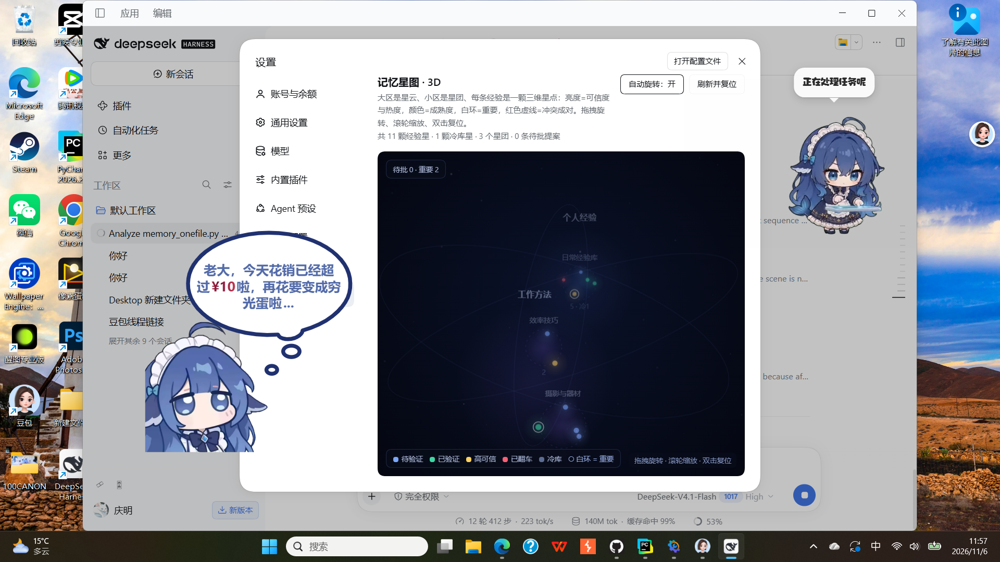
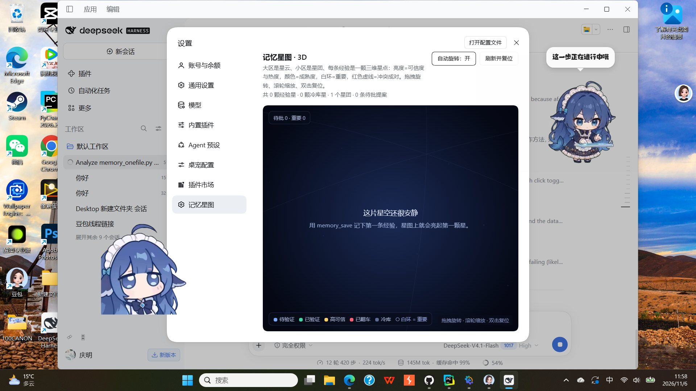

# dsh-memory · 通用大模型的长期记忆插件

[](LICENSE)
[](#环境要求)
[](https://www.python.org/)

**给 DeepSeek Harness 里任意大模型装上跨会话记忆。**

对话窗口一滚动，模型就忘了之前的事。`dsh-memory` 给它一个本地经验库：开新任务前先检索过往经验、
用户确认后沉淀新经验、事后回写效果——还能把整个库渲染成一张可交互的 **3D 星图**。

全部本地存储、不绑定任何模型厂商、不依赖任何 npm 包。



## 特性

| | |
|---|---|
| 🔎 `memory_search` | 跨会话检索：相关度、可信度、成熟度、适用前提、反面坑、冲突、溯源、是否过时 |
| 📄 `memory_get` | 按 id 读取完整正文与全部元数据 |
| 📊 `memory_status` | 条数、冷库归档、待批提案、成熟度分布、数据位置 |
| 💾 `memory_save` | 沉淀一条经验：摘要/详情/标签/前提/坑/可信度/类型/重要标记/溯源 |
| 🔁 `memory_feedback` | good / bad / neutral 回写效果，推进成熟度（待验证→已验证→高可信，bad→已翻车） |
| 🌌 3D 星图 | 大区=星云、小区=星团、经验=星点；轨道相机、点星聚焦、待批提案变成可点的流星 |

内置的三条设计约束：

- **人在环里**：写入走 Harness 审批服务，审批不可用时失败关闭，绝不静默写库。
- **不静默覆盖**：冲突经验两条都保留，检索时成对返回。
- **可审计**：每条经验有版本号、溯源字段，成熟度只由显式 feedback 推进。

## 环境要求

- 支持插件的 DeepSeek Harness（桌面版或 CLI profile）
- Python **3.8+**（Windows 上是 `python`，macOS/Linux 上是 `python3`；也可用 `pythonExe` 指定）
- 无需 npm 依赖、无需构建：客户端是一段普通 JavaScript + Canvas

## 安装

### 1. 获取代码

```bash
git clone https://github.com/hong1413/dsh-memory.git
```

或者直接下载仓库 ZIP 解压——这个目录本身就是插件包。

### 2. 安装到 DSH profile

让代理（或插件页）按目录安装：

```
plugin_manager: install_bundle  target = <dsh-memory 目录的绝对路径>
```

安装完，5 个 `memory_*` 工具就会出现在模型的工具列表里。

> **客户端需要重启一次**：3D 星图跑在 Web UI 里，首次安装后请关掉再打开 DeepSeek Harness 一次；
> 之后修改 `client.js` 只需刷新页面。

### 3. 配置（可选）

配置是插件行上的一个普通对象，所有字段都有可用默认值，留空即可：

```yaml
- insert:
    - id: dsh-memory
      name: 'dsh-memory'
      config:
        dataDir: 'C:\Users\you\AppData\Local\doubao-memory\data'
        # pythonExe: 'python'
        # timeoutMs: 30000
        # maxResults: 6
        # allowWrites: true
        # requireApproval: true
        # allowUiWrites: true
        # promptHint: true
```

| 字段 | 默认 | 说明 |
|---|---|---|
| `dataDir` | `%LOCALAPPDATA%\doubao-memory\data` | 记忆库位置（其他平台在 `~/.local/share`） |
| `scriptPath` | 包内 `memory_onefile.py` | 想用你自己的引擎副本时指定 |
| `pythonExe` | `python` / `python3` | Python 解释器 |
| `maxResults` | `6` | `memory_search` 默认返回条数 |
| `timeoutMs` | `30000` | 单次命令超时 |
| `allowWrites` | `true` | 关掉后只留只读工具 |
| `requireApproval` | `true` | 写入前请求用户批准 |
| `allowUiWrites` | `true` | 星图上的「批准/驳回」按钮 |
| `promptHint` | `true` | 注入一小段系统提示，告诉模型何时检索/何时沉淀 |

## 怎么用

直接用自然语言对模型说：

```
我上次是不是记过二手相机怎么验机？         → 它会先调 memory_search
记一下：买二手相机先查快门数再测跑焦。      → 用户确认后 memory_save
这套经验管用，帮我回写一下。                → memory_feedback good
```

也可以完全不用 Harness，用终端驱动同一个引擎：

```bash
python memory_onefile.py remember "二手相机验机：先查快门数再测跑焦" \
  --premise "线下当面验机" --counter "仅线上看图交易不适用" \
  --score 0.85 --case-type success --tags 相机,验机

python memory_onefile.py search "二手相机 验机" --json
python memory_onefile.py status
python memory_onefile.py selftest     # 16 项内置断言
```

完整命令见 `python memory_onefile.py --help`。

## 3D 星图

设置 → **记忆星图**：

- **大区**渲染成星云，**小区**渲染成星团，每条**单元**是一颗星：大小/亮度=可信度与热度，
  颜色=成熟度（蓝=待验证、绿=已验证、金=高可信、红=已翻车）
- **重要**经验带白环；**冲突**经验之间画红色虚线；冷库归档单独成暗色星域
- **交互**：拖拽旋转、滚轮缩放、双击复位、自动旋转开关；悬停看摘要；
  **点星镜头飞过去聚焦**；点缓缓下坠的**流星**可以批准/驳回待批提案
- 相机距离按场景包围球自适应，数据多少都能完整入画
- 空库显示引导文案，而不是一片空白



### 只读数据口

页面通过一个同源只读接口取数：

```http
GET /dsh-memory/starmap.json
→ { ok, generatedAt, dataDir, zones[], subzones[], units[], cold[], mirrors[], proposals[], stats{} }
```

### 提案操作（唯一写路由）

星图上的按钮 POST 到这里；这一下点击就是「人工批准」：

```http
POST /dsh-memory/proposals   { "id": "p_xxxxxxxxxxxx", "action": "approve" | "reject" }
→ { ok: true, message: "..." }
```

只接受 pending 提案：`approve` 执行 `approve --execute`，`reject` 执行 `reject -r "界面驳回"`。
不想要这个入口就把 `allowUiWrites` 设为 `false`。

## 数据布局

单元一条一个 JSON（`main_library/units/`），版本快照在 `forget_layer1/snapshots/`，
冷封存在 `forget_layer2/cold_units/`，提案在 `proposals/`。结构稳定、人可读，
可以直接备份、diff 或用普通工具迁移。

单元字段：`summary`、`content`、`tags`、`premise`、`counter`、`score`、`case_type`、`pinned`、
`source_ref`、`maturity`、`version`、`conflict_ids`、`active_score`、`access_unseal_count`。

## 安全说明

- 两个 HTTP 路由只绑定 Harness Web 服务的 `127.0.0.1`，没有额外鉴权（单机单人工具的取舍）。
  在意的话设 `allowUiWrites: false`。
- 模型写入走审批服务；没有审批服务或没有会话上下文时**失败关闭**，不会静默写库。
- 插件不修改会话日志、不注册自定义会话事件，除 `dataDir` 外不写任何位置。

## 常见问题

**装好了但设置里没有「记忆星图」？** 客户端插件在应用启动时加载，重启一次 DeepSeek Harness。

**记忆存在哪？** 调 `memory_status`，或看「数据位置」一行；多个安装指向同一个 `dataDir` 即可共用一套库。

**不用 DSH 能用吗？** 能，`memory_onefile.py` 是一个完整的独立 CLI（30+ 子命令）。

**怎么重置？** 停用插件，删掉 `dataDir`，重启；插件不会在别处留数据。

## 贡献

欢迎 issue / PR。引擎自带自检：`python memory_onefile.py selftest`（16 项断言）。

## 许可证

[MIT](LICENSE) © 2026 dsh-memory contributors
